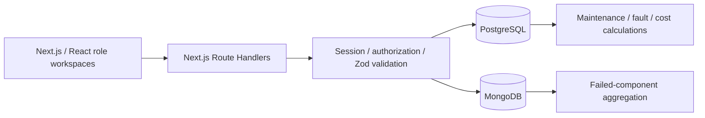

# Motive · Smart Vehicle Service and Maintenance Intelligence System

A working DBMS mini-project built with **Next.js, PostgreSQL, and MongoDB**. Customers book participating workshops, staff record inspections and completed work, and maintenance reminders explain what is due based on dates, mileage, and service history.

## Start locally

Requires **Node.js 22.13+** (Node 24 recommended), npm, and a running Docker engine. The setup script uses Docker directly, so the Docker Compose plugin is not required.

```bash
npm install
npm run setup
npm run dev
```

Open **http://localhost:3000**.

`setup` generates an ignored `.env.local` with random database credentials and a random demo password, creates two local-only database containers with persistent volumes, applies migrations, and seeds the demonstration. It preserves existing work on subsequent runs and extends future demo availability.

### Demo sign-ins

| Role | Email | Workspace |
|---|---|---|
| Customer | `customer@motive.test` | Garage, instant booking, history, maintenance, spending |
| Centre staff | `staff@motive.test` | Motive Central work queue, slots, inspection, completion |
| Administrator | `admin@motive.test` | Centres, staff access, platform reports |

All seeded accounts use **`DEMO_PASSWORD` in your generated `.env.local`**. Read that one value locally and enter it on the login screen. The account buttons select the email; they do not bypass authentication.

Additional staff: `staff2@motive.test`, `staff3@motive.test`. Additional customers: `customer2@motive.test` through `customer10@motive.test`.

New customers can also register from the sign-in screen. A customer never chooses or grants their own role.

## What is implemented

- Three roles with backend role, ownership, and centre checks.
- Customer registration, bcrypt password hashes, revocable cookie sessions, logout, and account deactivation.
- Administrator-managed centres and staff accounts.
- Multiple customer vehicles and non-decreasing odometer updates.
- Centre-specific hourly arrival slots, capacity-safe instant booking, cancellation, job start, and no-show transitions.
- Retry-safe reservations and duplicate-safe service completion.
- Flexible MongoDB inspection checklists, measurements, notes, database validation, and revision conflict detection.
- Atomic PostgreSQL completion covering service items, charges, mileage, booking state, and status audit.
- Vehicle history across centres; staff can access only their own centre's jobs.
- Configurable month/km maintenance rules with end-of-month handling, missing-baseline and stale-mileage flags.
- Repeated-fault detection across distinct services in the last 180 days.
- Monthly charges, service-category spending, centre activity, booking distribution, MongoDB aggregation, and CSV export.
- Responsive customer/staff/admin interfaces with dialog forms, errors, empty states, and keyboard navigation.

Slots are arrival windows, not guaranteed repair completion times. Recorded charges are not payment receipts. Demo maintenance intervals are illustrative and configurable.

## Demo workflow

1. **Admin:** inspect the three seeded centres, create a centre, or create/deactivate a staff account.
2. **Staff:** open Arrival slots; publish a whole-hour start from 09:00 to 17:00 within the next 30 days. Demo slots already cover the next seven days.
3. **Customer:** open My garage, choose Book a service, select centre/service/date/time, add the concern, and confirm.
4. **Customer:** view booking details or cancel before the arrival window begins.
5. **Staff:** open Work queue. A seeded in-progress job is ready for inspection/completion; another past arrival can be started. Future bookings cannot be started early.
6. **Staff:** record checklist results/measurements, save the inspection, then enter a completion summary, mileage, and itemized charges.
7. **Customer:** view Service history, Maintenance, and Insights & spending. A matching completed service becomes the maintenance baseline.

A separate seeded past arrival makes the demo work without changing the real scheduling rules. No-show marking becomes available 30 minutes after arrival time.

## Architecture



The application has one responsive browser workspace at `/`; navigation switches role-specific views without a full page load. All persistence goes through the authenticated API under `/api`. This keeps the small academic project compact; the SRS's proposed separate page folders are consolidated into a shared workspace component.

### PostgreSQL

Tables: `service_centres`, `users`, `sessions`, `vehicles`, `service_types`, `fault_codes`, `service_slots`, `bookings`, `service_records`, `service_items`, `maintenance_rules`, `booking_status_history`.

Advanced database features:

1. **Transactions and explicit row locks:** capacity-safe booking and all-or-nothing service completion.
2. **Stored functions:** reservation, workflow transitions, completion, mileage, slot publishing, and maintenance-rule updates.
3. **Triggers:** status audit, mileage/ownership protection, immutable referenced slots, baseline integrity.
4. **Views:** charge totals, joined vehicle history, centre booking summaries.
5. **Indexes:** occupancy, ownership, history, request-key uniqueness, one in-progress job per vehicle.
6. **MongoDB aggregation:** failed inspection components by centre/date.

The runtime PostgreSQL account cannot directly modify bookings, completed work, mileage, or the audit history. Controlled functions verify the actor again. The migration owner has separate credentials.

### MongoDB

`job_inspections` stores a booking's variable checklist and measurements. `$jsonSchema` rejects malformed documents; a unique booking index prevents duplicates. Revision-matched updates prevent silent overwrites.

PostgreSQL references are verified before document writes. Inspection editing and completion use the same vehicle/booking lock order. This coordinates timing, but **does not create a distributed transaction**. After an uncertain save, reload the document. Inspection failures are explicit and core SQL booking remains independent.

## Commands

| Command | Purpose |
|---|---|
| `npm run setup` | Create/start local databases, migrate, seed |
| `npm run dev` | Development app on port 3000 |
| `npm run build` | Production compilation and TypeScript checks |
| `npm start` | Serve the production build |
| `npm run db:migrate` | Apply missing SQL migrations, Mongo validator/indexes, runtime grants |
| `npm run db:seed` | Seed once; extend availability on later runs |
| `npm run db:check` | Check orphan inspections, incomplete records, state mismatches, and excess occupancy |
| `npm test` | Maintenance calculation unit tests |
| `npm run test:integration` | Real PostgreSQL/MongoDB concurrency and integrity tests |
| `npm run test:e2e` | Browser workflows and API security checks; app must already be running |
| `npm run test:resilience` | Explicit local MongoDB outage exercise; run separately from other tests |
| `npm run typecheck` | TypeScript validation |

For browser tests, install the test browser once:

```bash
npx playwright install chromium
npm run test:e2e
```

The database integration tests create isolated UUID-based fixtures and remove them. Browser tests create synthetic test records; their cleanup removes those fixtures. Use a local demonstration database for testing.

### Database containers

- `motive-postgres`: PostgreSQL 17, bound to `127.0.0.1:54329`.
- `motive-mongo`: MongoDB 8.0, bound to `127.0.0.1:27029`.
- Persistent Docker volumes: `motive-postgres-data`, `motive-mongo-data`.

Stop the databases when finished:

```bash
docker stop motive-postgres motive-mongo
```

Run `npm run setup` to start them again. Do not delete `.env.local` while retaining these database volumes: it contains the credentials originally used to initialize them.

For an existing external database setup, copy `.env.example` to `.env.local`, fill the real URLs/password, and run migrate then seed. The provided migration script provisions the `motive_app` roles, so its admin connections require appropriate role/user-management privileges. `npm run setup` is specifically for the default local Docker ports.

## Configuration and security

- `.env.local` is ignored and generated with file mode `0600`; `.env.example` contains placeholders only.
- SQL queries are parameterized. API payloads are validated, and database constraints enforce integrity.
- Mutations require an `Origin` matching `APP_ORIGIN`. Change it if serving the app on another origin/port.
- Session cookies are HttpOnly and SameSite=Lax; deployed HTTPS uses Secure cookies.
- Sessions expire after 24 hours. Inactive staff cannot use an existing session.
- Login/registration use an in-memory rate limiter for the single-process local build. A multi-instance deployment needs a shared limiter.
- Session tokens are random; only SHA-256 token hashes are persisted. Passwords are bcrypt hashes.
- Passwords require 10 characters and at most 72 UTF-8 bytes.
- Do not deploy this development environment or demo credentials unchanged as a public service. Password recovery/email verification, shared rate limiting, operational backups, and production infrastructure are future work.

## Project files and academic documentation

- `docs/SRS-Implementation-Blueprint.md`: scope, workflows, ER diagram, data dictionary, API contract, acceptance scenarios, and two-member implementation plan.
- `docs/IMPLEMENTATION.md`: implemented boundaries and data flow.
- `docs/TEST-RESULTS.md`: recorded verification and limits.
- `db/migrations/`: core schema, constraints, functions, triggers, views, indexes, and controlled inspection locking.
- `db/demo-queries.sql`: DDL/DML, joins, subqueries, aggregates, HAVING, audit and index examples.
- `db/mongo-examples.js`: document validator/index inspection and aggregation examples.
- `scripts/check.ts`: cross-database consistency checks.
- `docs/screenshots/`: captured desktop/mobile screenshots for the report.
- `output/screenshots/`: fresh screenshots generated by browser tests (ignored output).

The repository is prepared for a two-person team. Record each member's **actual** commits and contributions as work proceeds; the SRS responsibility table is a proposed division, not a claim about who authored this generated implementation.

## Troubleshooting

- **Docker unavailable:** start the Docker engine and verify `docker info` works for your user.
- **Port conflict:** ports 3000, 54329, and 27029 must be available for the default setup. Keep API origin and database URLs aligned if changing them.
- **Authentication fails:** use the generated `DEMO_PASSWORD`; do not use `.env.example` placeholders. New credentials do not replace existing seeded account hashes on rerun.
- **No times on the chosen date:** rerun the seed command to extend availability, or publish slots as staff.
- **Cannot start a future job:** this is intentional. Use the seeded in-progress/past-arrival jobs to demonstrate completion.
- **Cannot complete with lower mileage:** refresh vehicle details and correct the odometer entry.
- **Inspection unavailable:** check the MongoDB container; booking/history use PostgreSQL and remain separate.
- **Inspection revision conflict:** reload the latest document before applying your changes.
- **A restart loses the selected screen:** the compact workspace stores the current view in browser state; persisted records remain in the databases.
