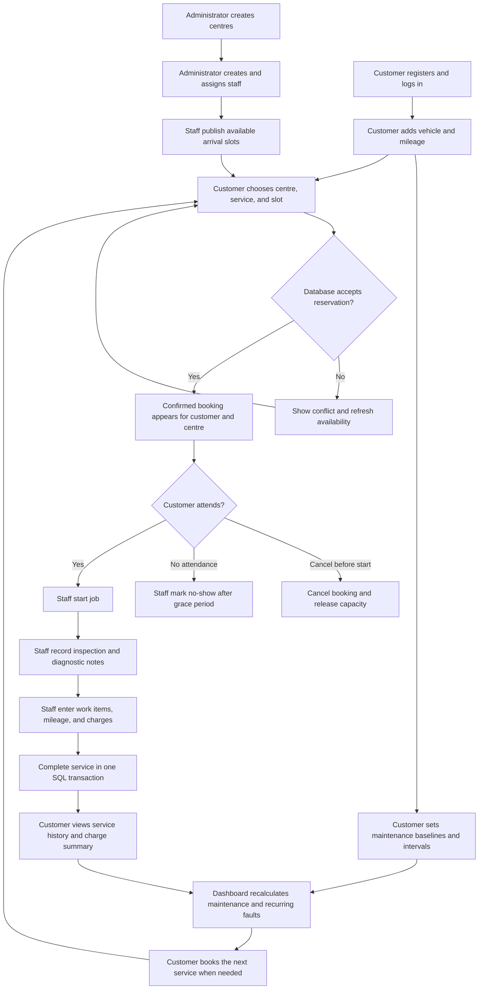
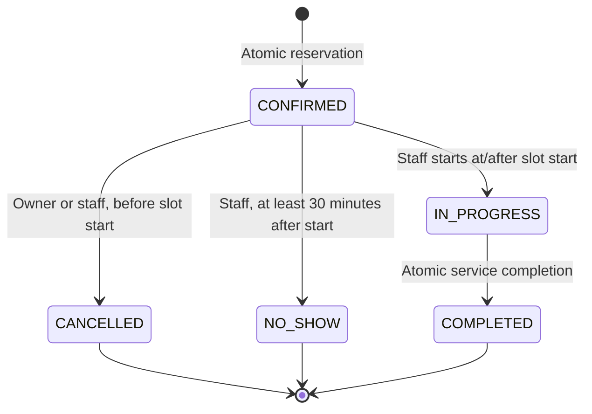
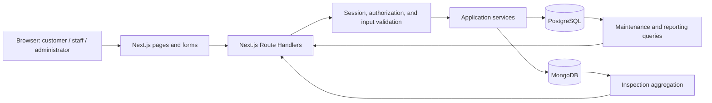
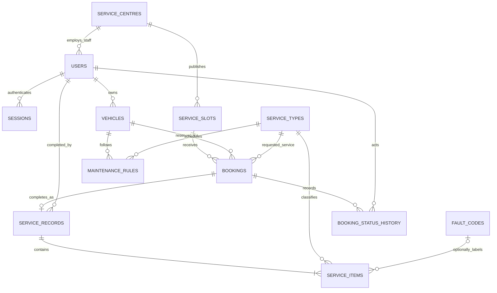

# Smart Vehicle Service and Maintenance Intelligence System

## Software Requirements Specification and Implementation Blueprint

**Version:** 1.0  
**Prepared:** 20 October 2026  
**Delivery target:** Two-member DBMS mini-project, developed in 2–3 weeks  
**Document status:** Implementation baseline. The local application is implemented; see IMPLEMENTATION.md for boundaries and TEST-RESULTS.md for measured verification.

---

## 1. Purpose and requirement sources

This document describes what the system must do, how users move through it, how information is stored, and how the implementation will be verified. It combines a software requirements specification (SRS) with an implementation sequence suitable for the project team.

### 1.1 Course requirements

Source: `DBMS Level 3 Project Requirements draft.pdf`, supplied at `/home/bae/sem5/dbms/jackfruit/DBMS Level 3 Project Requirements draft.pdf`.

The course requires:

- A meaningful problem and functionality beyond basic create/read/update/delete operations.
- A two-member team, with both members contributing to database and application development.
- At least two database paradigms with a problem-based justification.
- ER modelling, a relational schema, keys, constraints, and documented non-relational data models.
- Appropriate DDL, DML, complex queries, and at least four advanced database concepts.
- A Next.js web interface integrated with a backend/API layer.
- Authentication and at least two roles where relevant.
- Database-level validation, basic application security, and environment-based configuration.
- Documentation, Git/GitHub history, tests, and an individual-contribution demonstration.

The PDF explicitly describes vector search as optional. This project uses PostgreSQL and MongoDB; embeddings and a vector database are not part of this version.

### 1.2 Confirmed project choices

The user selected:

1. Multiple service centres.
2. Instant booking into available slots.
3. Administrator-managed centres and staff.
4. Rules and analytics for maintenance intelligence.
5. A 2–3 week implementation window.

The remaining detailed rules in this document are proposed implementation defaults. They are design choices for this project, not additional requirements imposed by the PDF.

### 1.3 Terminology

| Term | Meaning |
|---|---|
| Centre | A vehicle service workshop registered by an administrator |
| Slot | A one-hour arrival window with a maximum number of vehicle bookings |
| Booking | A customer's reservation for a vehicle at a centre |
| Job | The servicing activity associated with a booking |
| Inspection | Flexible checklist results and diagnostic notes stored in MongoDB |
| Service record | The completed work, mileage, and charges stored in PostgreSQL |
| Maintenance rule | A time and/or mileage interval for a vehicle and service type |
| Fault code | A controlled application category such as `BRAKE_NOISE`; it does not imply a manufacturer diagnostic code |

## 2. Problem statement, objectives, and scope

### 2.1 Problem statement

Vehicle owners may have service records spread across workshops and may forget maintenance dates or mileage thresholds. Workshops also need a reliable way to manage appointments and record completed work. Basic appointment systems do not necessarily connect these records to explainable maintenance reminders or recurring-problem detection.

The proposed application keeps a customer's vehicle history across participating centres, manages centre-specific appointment capacity, and converts completed service records into useful maintenance information.

### 2.2 Objectives

- Let a customer manage multiple vehicles and instantly reserve an available arrival slot.
- Let centre staff manage bookings, record inspections, and complete service jobs.
- Preserve a consistent service history across participating centres.
- Identify maintenance that is due or approaching its interval.
- Highlight recurring faults using historical records.
- Show maintenance spending and centre workload.
- Demonstrate meaningful SQL and document-database functionality.

### 2.3 Included in the first version

- Passenger cars; one owner per vehicle.
- Customer, centre-staff, and administrator roles.
- Administrator-created centres and staff accounts.
- A shared service catalogue available at every active centre.
- Manual mileage entry and configurable maintenance intervals.
- Instant booking, cancellation, no-show marking, inspections, and service completion.
- Maintenance alerts, repeated-fault detection, cost reports, and inspection analytics.
- Local setup, reproducible demo data, tests, and academic documentation.

### 2.4 Future enhancements

Online payments, spare-parts inventory, invoice/tax processing, mechanic assignment, live GPS/OBD data, manufacturer integrations, email/SMS reminders, document uploads, semantic search, and predictive ML are outside the first release.

There is no public centre registration, vehicle ownership transfer, customer-submitted historical invoice import, or booking rescheduling workflow in this version. Customers cancel and make a new booking; the replacement reservation is subject to availability.

### 2.5 Operating defaults

- Currency: INR.
- Distance: kilometres.
- Display/business timezone: `Asia/Kolkata`.
- Timestamps: UTC using PostgreSQL `timestamptz`; date-only maintenance values use `date`.
- Service intervals: configurable demonstration values, labelled accordingly.
- Local demonstration first; hosted deployment is a later packaging decision.
- The project began from an empty workspace; implementation now accompanies this specification.

## 3. Actors and access boundaries

| Capability | Customer | Centre staff | Administrator |
|---|---|---|---|
| Register a customer account | Yes | No | No |
| Manage vehicles and mileage | Own vehicles | Record mileage during own-centre completion | No |
| Browse active centres and available slots | Yes | Own-centre scheduling view | All-centre summary |
| Create a booking | Own vehicle | No | No |
| Cancel a booking | Own confirmed booking before start | Own-centre confirmed booking before start | No |
| Publish/change/delete unused slots | No | Own active centre | No |
| Start a job / mark no-show | No | Own centre | No |
| Save an inspection / complete a job | No | Own centre | No |
| View service records and saved inspections | Own vehicles across centres | Own centre's jobs | Aggregate reports only |
| Configure maintenance rules | Own vehicles | No | No |
| View maintenance alerts and spending | Own vehicles | Own-centre operational reports | Aggregate reports |
| Manage centres and staff accounts | No | No | Yes |

Each staff account is assigned to exactly one centre. Customers and administrators have no staff-centre assignment. Staff access does not extend to another centre's historical job notes.

The server derives the actor from the authenticated session. Client-submitted role, customer ID, or centre ID must never grant access. Hiding a button is not authorization.

## 4. Overall workflow



An inspection is recommended but optional in version 1. A failed inspection save is clearly reported; it must never be presented as saved. SQL service completion remains available because inspections and service records have independent persistence boundaries.

## 5. Detailed user workflows

### WF-01: Administrator prepares the platform

**Precondition:** An administrator account is provisioned through a setup command.

1. Administrator logs in and opens the centre-management screen.
2. Creates a centre with name, address, city, and contact number.
3. Creates a staff account with a name, unique email, initial password, and centre assignment.
4. The application hashes the password before saving it.
5. Staff logs in and sees only the assigned centre.

**Result:** The centre can publish slots and receive bookings.

Deactivating a centre prevents new reservations and new slots. Existing bookings remain visible and may be completed or cancelled under the normal rules. Show the number of outstanding bookings before deactivation. Staff reassignment is deferred: administrators can deactivate an account and create a separate account for another centre.

### WF-02: Customer registers and adds a vehicle

1. Customer registers with name, email, and password.
2. The server creates a customer-only account and starts a session.
3. Customer enters registration number, make, model, model year, current mileage, and optional last-service information.
4. Registration is normalized to uppercase without whitespace; punctuation other than an optional hyphen is rejected.
5. The server validates the data, then PostgreSQL enforces uniqueness and numeric constraints.
6. Customer adds maintenance rules for relevant services.

**Result:** The vehicle appears in the customer's garage.

Unknown last-service data remains empty. Never invent a last-service date, treat vehicle registration as a service, or assume mileage zero. Vehicle ownership is immutable in this release. Model year is restricted to 1900–2100, and current mileage is a nonnegative integer.

### WF-03: Customer instantly books a service

**Preconditions:** Authenticated customer, owned vehicle, active centre, available future slot.

1. Select a vehicle.
2. Browse/filter centres by name or city.
3. Select a centre and service type.
4. Select a future arrival slot showing remaining spaces.
5. Enter a short complaint or reason for service.
6. Submit the reservation with a generated request UUID.
7. The server authenticates the customer and invokes the booking database function.
8. PostgreSQL verifies ownership, centre status, capacity, and conflicting vehicle reservations.
9. On success, return the booking reference and `CONFIRMED` status.
10. Show the booking in both the customer's upcoming bookings and the centre's work queue.

**Conflict path:** Return a booking-conflict response and refresh available slots. Do not silently select a different slot.

**Retry path:** Reusing the same request UUID and the same booking inputs returns the existing booking. Reusing it with different inputs returns a conflict. The UI retains that UUID after a network timeout until it knows the outcome.

### WF-04: Customer or staff cancels a booking

1. Open a confirmed booking before its start time.
2. Select Cancel and confirm the selected booking.
3. Server verifies ownership or centre membership.
4. Database changes the status to `CANCELLED` and records the actor and timestamp.
5. Slot availability increases because cancelled bookings no longer consume capacity.

Cancellation and slot reuse are transactional. Repeating cancellation returns the existing cancelled result. Cancellation is unavailable once servicing begins or the arrival window has started.

### WF-05: Staff receives and inspects a vehicle

1. Staff opens the centre queue and filters by date/status.
2. For an attending customer, staff starts a confirmed job at or after the slot start.
3. Staff opens the inspection form.
4. Adds component results such as brakes, tyres, battery, fluids, and lights.
5. Records each result as `PASS`, `ATTENTION`, or `FAIL`, with optional measurements and comments.
6. Saves diagnostic notes to MongoDB.
7. Continues to service completion.

Inspection edits are allowed only while the booking is `IN_PROGRESS`. Use a document revision number to prevent one staff member from silently overwriting another's changes. Customers see saved inspections after completion.

If a confirmed customer has not arrived 30 minutes after the start time, staff may mark `NO_SHOW`. The system does not infer attendance or automatically mark no-shows.

### WF-06: Staff completes service

**Precondition:** Own-centre booking is in progress.

1. Enter the completion mileage.
2. Enter a completion summary.
3. Add 1–50 service items, each with service type, description, quantity, unit price, and an optional controlled fault code.
4. Review calculated charges.
5. Submit Complete service.
6. PostgreSQL atomically saves the record/items, updates mileage, completes the booking, and records status history.
7. Return the completed record and charge total.

The completion timestamp is assigned by the server/database. It is not editable through the application. A repeated completion request returns the already completed record; completed records and their items are immutable through normal application endpoints.

If the owner has submitted a higher current mileage than the completion form, completion fails with a clear mileage-conflict message. Staff must resolve the entry rather than silently lowering mileage.

### WF-07: Customer reviews vehicle health and spending

1. Open the dashboard or a vehicle's detail page.
2. View upcoming bookings and completed service history.
3. Review maintenance cards containing status, evidence, and next thresholds.
4. Review recurring faults with links to matching service records.
5. View monthly spending and service-category totals.
6. Update stale mileage or book another service.

All calculations are refreshed when requested; no scheduler or push-notification service is needed.

## 6. Booking states and scheduling rules



### Scheduling rules

- Each slot is exactly one hour and starts on a whole hour in Asia/Kolkata.
- Capacity is an integer from 1 to 20; default 3.
- Slots for a centre have unique start times. Fixed, aligned durations prevent overlap.
- Staff can publish slots from 09:00 through 17:00 local time for the next 30 days.
- Booking is allowed only before the slot starts.
- A slot is an arrival-capacity reservation; jobs may last longer than one hour.
- Occupancy counts all bookings except `CANCELLED`.
- A vehicle cannot have two `CONFIRMED` or `IN_PROGRESS` bookings for the same arrival window across centres.
- A vehicle cannot have two jobs in progress simultaneously, even when their arrival slots differ.
- A slot's start/end times cannot be changed after creation.
- Staff can change capacity or delete a future slot only if it has never been referenced by a booking.
- Completed and no-show bookings remain in history and do not reopen an expired slot.
- Terminal booking states cannot transition to another state.

The UI may show stale availability; the database decision at submission is authoritative.

## 7. Functional requirements

“Must” identifies functionality required for this release.

| ID | Requirement | Acceptance condition |
|---|---|---|
| FR-01 | The system must support customer registration, login, logout, and session expiry. | Invalid credentials are rejected; logout invalidates the server session. |
| FR-02 | The system must enforce customer, staff, and administrator access. | Direct API calls outside role/ownership/centre boundaries fail. |
| FR-03 | Administrators must create, edit, and deactivate centres. | Deactivated centres cannot receive new bookings. |
| FR-04 | Administrators must create and deactivate centre-assigned staff. | Deactivated staff sessions cannot perform requests. |
| FR-05 | Customers must add and view their vehicles and update mileage. | Duplicate registrations and decreasing mileage fail. |
| FR-06 | Staff must publish and manage unused future slots. | Invalid durations, duplicate slots, and invalid capacity fail. |
| FR-07 | Customers must instantly book available slots. | Concurrent submissions cannot exceed slot capacity. |
| FR-08 | Eligible users must cancel confirmed future bookings. | Cancellation is audited and releases capacity exactly once. |
| FR-09 | Staff must start jobs and mark eligible no-shows. | Only defined state transitions and timing rules succeed. |
| FR-10 | Staff must save flexible inspection documents. | Valid documents persist; malformed or stale-revision writes fail. |
| FR-11 | Staff must complete jobs atomically. | Partial records, duplicate completions, and partial mileage updates cannot occur. |
| FR-12 | Customers must view vehicle history across centres. | Only records belonging to their vehicles are returned. |
| FR-13 | Customers must configure time/mileage maintenance rules. | Each vehicle/service pair has at most one rule with at least one positive interval. |
| FR-14 | The system must calculate explainable maintenance status. | The response includes its baseline, thresholds, and missing/stale-data flags. |
| FR-15 | The system must detect repeated faults. | A fault in at least two distinct completed jobs within 180 days is flagged. |
| FR-16 | The system must provide SQL-based cost and booking reports. | Dashboard totals match independent SQL calculations. |
| FR-17 | The system must aggregate MongoDB inspection results. | Failed-component counts can be filtered by centre and date range. |
| FR-18 | The repository must provide reproducible setup and demonstration scripts. | A clean local setup can migrate, seed, start, and run the documented checks. |

## 8. Maintenance intelligence rules

### 8.1 Inputs and baselines

For each vehicle/service-type rule, store:

- Interval in months, kilometres, or both.
- Optional initial last-service date and mileage.
- The vehicle's current mileage and its update timestamp.

Look up the latest completed service record containing that service type. If found, its completion date and mileage replace the initial baseline for both calculations. Otherwise, use the initial values independently.

The service type on actual completed line items drives the reset. Merely booking an oil change does not reset an oil-change interval.

### 8.2 Calculations

```text
next_due_date = baseline_date + interval_months
next_due_km   = baseline_km + interval_km
days_remaining = next_due_date - today's date in Asia/Kolkata
km_remaining   = next_due_km - current_vehicle_km
```

Use calendar-month addition with end-of-month clamping. For example, 31 January plus one month becomes the last day of February, not a fixed 30-day offset.

| Status | Rule |
|---|---|
| `DUE` | Any configured, calculable threshold has been reached or exceeded. |
| `DUE_SOON` | No threshold is due, and a calculable threshold is within 30 days or 500 km, inclusive. |
| `INSUFFICIENT_HISTORY` | No known threshold is due/soon, but at least one configured dimension lacks its baseline. |
| `UP_TO_DATE` | Every configured dimension can be calculated and all are outside the due-soon range. |

Missing dimensions remain visible even if another dimension establishes `DUE` or `DUE_SOON`. Do not let missing data suppress a known due condition.

Mileage older than 30 days produces a separate `mileage_stale` flag. Mileage results explicitly say “based on last recorded mileage.” Date-based results remain usable.

**Example:** An oil change at 25,000 km with a 5,000 km interval is due at 30,000 km. At 29,700 km it is due soon, with 300 km remaining. If its date threshold has already passed, the combined status is due.

### 8.3 Recurring-fault detection

- Use controlled `fault_codes`, not free-text matching.
- Group by vehicle and fault code.
- Count distinct completed service records within the preceding 180 days, inclusive.
- Flag groups with a count of at least two.
- Return the count, latest occurrence, and matching record IDs/dates.
- Multiple items with the same code in one job count as one occurrence.

The displayed interpretation is “Repeated issue recorded; consider inspection.” The system does not claim to predict failure or diagnose a mechanical condition.

### 8.4 Cost and operational analytics

- Customer: monthly charges, per-vehicle spending, and service-category totals.
- Staff: bookings by status, completed jobs, recorded charges, and common failed inspection components for their centre.
- Administrator: centre count, active staff count, booking distribution, and recorded charges by centre.
- Costs use completed records only. Cancelled/no-show bookings contribute zero charges.
- “Charges” are recorded service amounts, not proof of collected payment.
- Report date ranges use inclusive local start dates and exclusive next-day end boundaries converted to UTC.

## 9. System architecture and implementation stack



| Layer | Choice | Purpose |
|---|---|---|
| UI | Next.js App Router, React, TypeScript, responsive CSS | Role-specific pages, forms, tables, responsive layout |
| API | Next.js Route Handlers on Node.js | Same-origin backend; no separate Express service |
| SQL access | `pg`, parameterized SQL | Explicit queries, functions, migrations, and transaction control |
| Document access | Official MongoDB Node.js driver | Inspection validation, updates, indexes, aggregation |
| Input validation | Zod | Validate request shapes before database operations |
| Authentication | bcrypt password hashes; opaque cookie sessions | Password protection and revocable sessions |
| Testing | Unit tests, real-database integration tests, Playwright | Rules, data integrity, and browser workflows |
| Local infrastructure | PostgreSQL and MongoDB containers | Repeatable development and evaluation setup |
| Version control | Git/GitHub | Reviewable source and individual contributions |

Select compatible stable package versions at implementation kickoff and commit the lockfile. Do not rely on unpinned global packages.

PostgreSQL is the source of truth for identities, ownership, bookings, work, mileage, and money. MongoDB stores varied inspection details. Neither database duplicates the other's authoritative state.

## 10. Data design

### 10.1 Relational conventions

- Entity IDs are UUIDs unless stated otherwise.
- `created_at` defaults to the database time.
- Foreign keys use restrictive deletion for historical business data.
- Money uses fixed-precision `numeric`; API monetary values are decimal strings.
- Quantities and mileage are integers.
- Email is trimmed/lowercased and uniquely indexed.
- Role and workflow status use constrained text values.
- Cross-row rules are enforced through database functions/triggers, not only browser validation.

### 10.2 Table dictionary

| Table | Key attributes | Relationships and constraints |
|---|---|---|
| `service_centres` | `id`, `name`, `address`, `city`, `phone`, `active`, `created_at` | Required nonblank descriptive fields; no hard deletion through UI |
| `users` | `id`, `name`, `email`, `password_hash`, `role`, `centre_id`, `active`, `created_at` | Unique normalized email; centre required only for `STAFF`; centre FK |
| `sessions` | `id`, `user_id`, `token_hash`, `expires_at`, `created_at` | User FK; unique token hash; raw session token is never stored |
| `vehicles` | `id`, `owner_id`, `registration`, `make`, `model`, `model_year`, `current_km`, `mileage_updated_at`, `created_at` | Owner must be a customer; unique registration; mileage ≥ 0; ownership immutable |
| `service_types` | `id`, `code`, `name`, `description` | Unique service code; seeded shared catalogue |
| `fault_codes` | `code` (text PK), `label`, `component` | Seeded controlled fault categories |
| `service_slots` | `id`, `centre_id`, `starts_at`, `ends_at`, `capacity`, `created_at` | Centre FK; unique centre/start; one-hour duration; aligned start; capacity 1–20 |
| `bookings` | `id`, `vehicle_id`, `slot_id`, `requested_service_type_id`, `complaint`, `status`, `request_key`, `created_at`, `updated_at` | Vehicle/slot/service FKs; unique request UUID; state constrained |
| `service_records` | `id`, `booking_id`, `completed_by`, `completed_at`, `odometer_km`, `summary` | Unique booking FK; staff-user FK; one completed record per booking |
| `service_items` | `id`, `record_id`, `service_type_id`, `description`, `quantity`, `unit_price`, `fault_code` | Record/type/fault FKs; quantity 1–100; `numeric(12,2)` unit price between 0 and 1,000,000 |
| `maintenance_rules` | `id`, `vehicle_id`, `service_type_id`, `interval_months`, `interval_km`, `baseline_date`, `baseline_km` | Unique vehicle/service pair; months 1–120 and/or km 1–1,000,000; baseline mileage ≥ 0 |
| `booking_status_history` | `id`, `booking_id`, `from_status`, `to_status`, `actor_id`, `changed_at` | Booking/user FKs; initial status entry has null `from_status`; generated by trigger |

Do not store an independently editable service total. Calculate `SUM(quantity * unit_price)` from service items, avoiding conflicting totals.

Baseline dates cannot be in the future, and baseline mileage cannot exceed current vehicle mileage. Updating a maintenance rule checks these conditions in the database. Decreasing a vehicle's current mileage is rejected by a database trigger.

### 10.3 ER relationship overview



The centre relationship applies only to staff users; customer/admin `centre_id` is null. The diagram shows structural relationships; role restrictions and minimum-item requirements also need constraints/functions.

### 10.4 MongoDB inspection model

Collection: `job_inspections`.

```json
{
  "_id": "MongoDB ObjectId",
  "booking_id": "PostgreSQL booking UUID",
  "vehicle_id": "PostgreSQL vehicle UUID",
  "centre_id": "PostgreSQL centre UUID",
  "revision": 1,
  "items": [
    {
      "component": "brakes",
      "result": "ATTENTION",
      "measurements": [
        { "name": "pad_thickness", "value": 3.5, "unit": "mm" }
      ],
      "comment": "Inspect pads during service."
    }
  ],
  "diagnostic_notes": "Noise reported during low-speed braking.",
  "updated_by": "PostgreSQL staff UUID",
  "created_at": "BSON date",
  "updated_at": "BSON date"
}
```

The JSON above illustrates the document shape; actual timestamps are BSON dates.

- Require valid UUID strings, at least one checklist item, an integer revision, and BSON timestamps.
- Limit checklists to 50 items; notes to 5,000 characters; comments to 1,000 characters.
- Restrict results to `PASS`, `ATTENTION`, and `FAIL`.
- Give measurements typed `name`, numeric `value`, and `unit` fields.
- Unique index on `booking_id`.
- Compound index on `{ centre_id: 1, updated_at: -1 }`.
- Validate with MongoDB `$jsonSchema`; reject invalid writes.
- Aggregate using centre/date `$match`, `$unwind` items, result `$match`, and component `$group`.

### 10.5 Cross-database consistency

MongoDB cannot enforce PostgreSQL foreign keys. Every inspection save first verifies the booking, vehicle, centre, active staff membership, and permitted state in PostgreSQL. The server supplies vehicle/centre/actor identifiers; it does not trust those values from the client.

To serialize inspection edits against service completion, an inspection save holds the relevant PostgreSQL vehicle/booking locks while performing the bounded MongoDB write. Completion uses the same lock order. The MongoDB operation uses a short timeout and optimistic revision matching.

This is not a distributed transaction. A document may have saved even if the final network response is lost. On retry/conflict, refetch the inspection and show its current revision. Never report SQL rollback as proof that a MongoDB write was undone.

Bookings are not hard-deleted, and vehicle ownership is immutable, limiting dangling-reference risk. Completion does not require a successful MongoDB write. A small consistency-check command reports any document whose PostgreSQL booking no longer exists after administrative database changes.

## 11. Database functions, transactions, and indexes

### 11.1 Required database operations

| Operation | Responsibilities |
|---|---|
| `reserve_booking(actor_id, vehicle_id, slot_id, service_type_id, complaint, request_key)` | Validate actor/ownership, replay safe retries, lock resources, check capacity/conflicts, insert booking |
| `transition_booking(actor_id, booking_id, target_status)` | Check actor, timing, allowed transition, and one-in-progress-job rule |
| `complete_service(actor_id, booking_id, mileage, summary, items_json)` | Validate centre, mileage and items; insert record/items; update vehicle and booking atomically |
| `update_vehicle_mileage(actor_id, vehicle_id, mileage)` | Verify owner, serialize with completion, prevent regression, update freshness |
| `save_maintenance_rule(actor_id, vehicle_id, service_type_id, ...)` | Enforce ownership, interval bounds, and initial-baseline consistency |

Slots have database validation and a trigger that blocks editing/deleting referenced slots. A status-history trigger records changes using the actor set by the trusted database function. A booking guard rejects unsupported state transitions.

### 11.2 Booking transaction

1. Validate the active customer and lock the owned vehicle row.
2. Check for an existing request key. Return it only if ownership and original inputs match.
3. Acquire a shared lock on the active centre, then lock the slot row.
4. Check time, catalogue reference, active conflicting vehicle reservations, and occupied spaces.
5. Insert `CONFIRMED` booking; trigger inserts initial audit history.
6. Commit, then return success.

Booking and centre deactivation serialize through the centre lock. If deactivation commits first, booking fails. If booking commits first, it becomes an existing booking preserved during deactivation.

The lock order for job operations is vehicle → centre when needed → slot when needed → booking. All functions follow that order. Cancellation locks the same slot before releasing capacity. Use PostgreSQL `READ COMMITTED` transactions with explicit locks.

### 11.3 Service-completion transaction

1. Lock vehicle and booking in the documented order.
2. Verify active staff membership and booking state.
3. If already completed, return the existing record without making changes.
4. Validate mileage and 1–50 line items.
5. Insert service record and items.
6. Update vehicle mileage and freshness timestamp.
7. Change booking to `COMPLETED`; trigger adds audit history.
8. Commit.

Any failure rolls back every SQL write. The application calculates maintenance from completed records, so no separate alert cache needs synchronizing.

### 11.4 Database permissions

Use a migration/owner account for schema changes and a separate application account for runtime queries.

The runtime role must not directly insert/update/delete bookings, service records, service items, mileage, or audit history; grant execution on the controlled functions and only the ordinary table privileges needed elsewhere. Security-definer functions must use a fixed trusted `search_path`, schema-qualified objects, and no public execute grant.

The server supplies `actor_id` from a validated session. The database account belongs to the trusted backend, never to a browser. Database functions still verify actor role and ownership as a second boundary.

### 11.5 Views and indexes

Views:

- `service_charge_totals`: one total per completed record.
- `centre_booking_summary`: booking counts by centre/date/status.
- `vehicle_service_history`: joined booking, centre, record, and charge information.

Indexes:

- Unique normalized user email and vehicle registration.
- `vehicles(owner_id)`.
- Unique `service_slots(centre_id, starts_at)`.
- `bookings(slot_id, status)` for occupancy.
- `bookings(vehicle_id, status)` for conflicts/history.
- Unique booking request key and unique service-record booking.
- `service_records(completed_at)` and `service_items(record_id, service_type_id)`.
- `service_items(fault_code, record_id)` for fault queries.
- Unique `maintenance_rules(vehicle_id, service_type_id)`.
- Unique session-token hash and `sessions(expires_at)`.

These demonstrate at least six advanced concepts: transactions, stored functions, triggers, views, indexing, and NoSQL aggregation.

## 12. API contract

All routes are under `/api`. UUIDs are strings; instants are ISO 8601 UTC strings; money is returned as decimal strings.

Success envelope: `{ "data": ... }`.  
Error envelope: `{ "error": { "code": "...", "message": "...", "fields": {} } }`.

List endpoints use `page` and `pageSize`, default 20, maximum 100, and return `items`, `page`, `pageSize`, and `total`.

### 12.1 Endpoints

| Method and path | Input/purpose | Access |
|---|---|---|
| `POST /auth/register` | Name, email, password; creates customer | Public |
| `POST /auth/login` | Email and password; sets session cookie | Public |
| `POST /auth/logout` | Invalidates session and clears cookie | Signed in |
| `GET /auth/me` | Current user and role | Signed in |
| `GET /catalogue` | Service types and fault codes | Signed in |
| `GET, POST /vehicles` | List own vehicles / add vehicle | Customer |
| `GET, PATCH /vehicles/:id` | View/edit own descriptive vehicle fields | Customer owner |
| `PATCH /vehicles/:id/mileage` | New current mileage | Customer owner |
| `GET, PUT /vehicles/:id/maintenance-rules` | List / upsert one service-type rule | Customer owner |
| `GET /vehicles/:id/maintenance` | Computed statuses and recurring faults | Customer owner |
| `GET /vehicles/:id/history` | Completed records across centres | Customer owner |
| `GET /centres` | Active centres; name/city filter | Signed in |
| `GET /centres/:id/slots` | Future availability; date filter | Signed in |
| `POST /slots` | Start time and capacity for assigned centre | Staff |
| `PATCH, DELETE /slots/:id` | Change capacity / remove unused future slot | Own-centre staff |
| `GET /bookings` | Scoped list; date and status filters | Customer/staff |
| `POST /bookings` | Vehicle, slot, requested service, complaint, request UUID | Customer |
| `GET /bookings/:id` | Scoped booking detail and audit history | Owner/own-centre staff |
| `POST /bookings/:id/cancel` | Cancel eligible booking | Owner/own-centre staff |
| `POST /bookings/:id/start` | Begin job | Own-centre staff |
| `POST /bookings/:id/no-show` | Record eligible no-show | Own-centre staff |
| `GET /bookings/:id/inspection` | Saved inspection | Own-centre staff; owner after completion |
| `PUT /bookings/:id/inspection` | Expected revision, checklist, notes | Own-centre staff |
| `POST /bookings/:id/complete` | Mileage, summary, service items | Own-centre staff |
| `GET /reports` | Role-scoped costs/status/inspection results | Signed in |
| `GET, POST /admin/centres` | All centres / create centre | Administrator |
| `PATCH /admin/centres/:id` | Centre details or active state | Administrator |
| `GET, POST /admin/staff` | Staff list / create assigned staff | Administrator |
| `PATCH /admin/staff/:id` | Name or active state | Administrator |

### 12.2 Important request shapes

```json
{
  "vehicleId": "uuid",
  "slotId": "uuid",
  "serviceTypeId": "uuid",
  "complaint": "Brake noise at low speeds",
  "requestKey": "client-generated uuid retained across retries"
}
```

```json
{
  "odometerKm": 29700,
  "summary": "Inspected brakes and replaced front pads.",
  "items": [
    {
      "serviceTypeId": "uuid",
      "description": "Front brake-pad replacement",
      "quantity": 1,
      "unitPrice": "2400.00",
      "faultCode": "BRAKE_NOISE"
    }
  ]
}
```

Do not accept client-controlled completion time, total cost, actor ID, booking status, or inspection centre/vehicle identifiers.

### 12.3 Error semantics

| Status | Use |
|---|---|
| `400` | Invalid input, malformed UUID, invalid field length |
| `401` | Missing, expired, or revoked session |
| `403` | Role cannot perform the requested class of action |
| `404` | Resource absent or outside the caller's ownership/centre scope |
| `409` | Full slot, duplicate/conflicting booking, invalid transition, mileage conflict, or stale inspection revision |
| `429` | Authentication rate limit |
| `503` | Required database unavailable; provide a retryable message |
| `500` | Unexpected failure; log server-side details and return a generic response |

If a combined report cannot load MongoDB analytics, return the available SQL report with an explicit `inspectionAnalyticsAvailable: false` flag. Do not show unavailable results as zero.

## 13. UI screens and expected behaviour

| Screen | Main content and actions |
|---|---|
| Login / registration | Labelled forms, field errors, role-aware redirect |
| Customer dashboard | Due/soon maintenance, upcoming bookings, recent spending, mileage reminders |
| My vehicles | Vehicle cards/table, add vehicle, details, mileage update |
| Vehicle detail | Service timeline, maintenance rules, threshold explanations, repeated faults |
| Find service | Centre search/city filter, service selection, date/slot availability |
| Booking confirmation/detail | Reference, centre, local arrival time, status, allowed cancellation |
| Customer history | Filterable completed jobs, itemized recorded charges, saved inspection |
| Staff dashboard | Today's arrivals, in-progress jobs, no-shows, recent completions |
| Staff slot management | Date selector, add slot, available/occupied counts, unused-slot controls |
| Staff job detail | Complaint, authorized vehicle information, start/no-show actions, inspection and completion forms |
| Centre reports | Booking distribution, charges, failed inspection components |
| Admin dashboard | Centre/staff counts and centre-level activity |
| Admin management | Centre creation/edit/deactivation and staff creation/deactivation |

Every data screen must have loading, empty, failure, and populated states. Preserve unsaved form input after recoverable errors. Disable pending submit buttons, but rely on server/database safeguards for duplicate requests.

Use keyboard-accessible controls, visible focus indicators, labelled inputs, and status text alongside colour. Support a 360 px mobile viewport and normal laptop widths. Use tables on wider screens and readable cards/stacked layouts on smaller screens.

## 14. Security and non-functional requirements

### Security

- Hash passwords with bcrypt, cost 12. Require at least 10 characters and reject inputs over bcrypt's 72-byte input limit.
- Generate session tokens with at least 32 cryptographically random bytes; store only SHA-256 token hashes.
- Sessions expire after 24 hours. Logout deletes the session; inactive users fail every subsequent request.
- Cookies use `HttpOnly`, `SameSite=Lax`, path `/`, and `Secure` outside local HTTP development.
- For mutations, enforce same-origin requests against a configured application origin; never use GET for writes.
- Rate-limit login/registration in the single-process local build and document the need for a shared limiter before multi-instance deployment.
- Use parameterized queries and escaped React output; no user-provided HTML rendering.
- Validate request bodies and limit inspection/completion payloads to 256 KB.
- Keep database credentials in ignored environment files; commit placeholder-only examples.
- Never log passwords, session tokens, full database connection strings, or inspection-note bodies.
- Do not expose database connection strings through `NEXT_PUBLIC_*` variables.

### Quality targets

| ID | Target | Verification |
|---|---|---|
| NFR-01 | No overbooking or partial SQL service completion | Real concurrent integration tests and rollback tests |
| NFR-02 | Routine reads/updates complete within 2 seconds on the documented local test machine with 1,000 bookings | Record measured timings; report exceptions |
| NFR-03 | No cross-customer or cross-centre disclosure | Negative API authorization tests |
| NFR-04 | Core booking remains usable during a MongoDB outage | Dependency-failure test |
| NFR-05 | Setup is reproducible without manually editing database contents | Clean migration-and-seed exercise |
| NFR-06 | Interfaces are usable with keyboard and narrow viewports | Browser checks at 360 px and desktop widths |
| NFR-07 | Historical work cannot be accidentally deleted through UI/API | FK, privilege, and endpoint tests |

These are acceptance targets, not measured claims. Record actual results during implementation.

## 15. Proposed project structure and build order

```text
app/
  (auth)/                 login and registration
  (customer)/             dashboard, garage, booking, history
  staff/                  queue, slots, job forms, reports
  admin/                  centres, staff, summaries
  api/                    Route Handlers
components/
  forms/                  validated inputs and submission states
  tables/                 bookings, service items, histories
  dashboard/              maintenance and report components
lib/
  auth/                   session and authorization helpers
  db/                     PostgreSQL pool and MongoDB client
  validation/             request schemas
  services/               booking, service completion, inspections
  intelligence/           maintenance calculations and query mapping
db/
  migrations/             ordered SQL migrations
  mongo/                  validators and indexes
  demo-queries.sql        DDL/DML/advanced-feature examples
scripts/                  setup, migration, seed, consistency checks
tests/
  unit/
  integration/
  e2e/
docs/                     SRS, ER/schema, test results, report
```

### Phase 1 — Foundation and schema: days 1–2

Create the Next.js app, environment template, local database configuration, SQL migrations, MongoDB setup, and initial service/fault catalogues. Confirm both database connections.

**Exit condition:** A clean database setup produces all tables, constraints, indexes, and validators.

### Phase 2 — Identity and setup: days 3–4

Build sessions, authorization, registration/login, administrator centre/staff management, and customer vehicle screens.

**Exit condition:** All three roles sign in and cannot access another role's restricted data.

### Phase 3 — Reservation workflow: days 5–7

Implement slot management, reservation/state functions, booking screens, cancellation, and audit history. Write concurrency tests before polishing the screens.

**Exit condition:** Two callers competing for one remaining space cannot both succeed.

### Phase 4 — Job execution: days 8–10

Implement staff queue, inspection saving/revision control, no-show/start actions, atomic completion, customer history, and itemized charges.

**Exit condition:** A customer booking can become a completed service with correct history and mileage.

### Phase 5 — Intelligence and reports: days 11–12

Implement maintenance rules/calculations, repeated-fault queries, SQL reports, and MongoDB component aggregation.

**Exit condition:** Seeded due, due-soon, unknown-history, stale-mileage, and repeated-fault examples produce explained results.

### Phase 6 — Submission readiness: days 13–14

Run all checks, fix failures, verify a clean setup, capture screenshots, finalize the report, and rehearse the demonstration.

**Exit condition:** Acceptance tests pass and the documented demonstration can be repeated.

### Buffer — days 15–21, if available

Use the remaining time for defects, accessibility, setup reliability, and report quality. Do not add major features before the core workflow and evaluation evidence are complete.

## 16. Team ownership

| Member | Database responsibilities | Application responsibilities |
|---|---|---|
| Member 1 | Core PostgreSQL schema, reservation/state functions, SQL privileges, audit trigger, concurrency tests | Authentication, centre/staff administration, customer booking, slot management |
| Member 2 | MongoDB validator/indexes/aggregation, service-completion transaction, maintenance/reporting queries | Inspection and completion screens, vehicle history, maintenance and reporting dashboards |

Both members review migrations and API changes, maintain their own Git commits, and participate in end-to-end tests. Each should be able to explain one database feature and one application workflow during evaluation.

Keep an actual contribution log in the repository. Do not fabricate commits or assign credit based only on the planned division.

## 17. Verification and acceptance scenarios

| Test ID | Scenario | Expected result |
|---|---|---|
| AT-01 | Register with an existing normalized email | Rejected without creating a second account |
| AT-02 | Customer opens another customer's vehicle/booking URL | No data disclosed; 404 |
| AT-03 | Staff attempts another centre's booking or inspection | Rejected; no changes |
| AT-04 | Customer sends admin/staff fields during registration | Fields rejected; account remains customer |
| AT-05 | Two different vehicles request the last space concurrently | Exactly one booking succeeds; the other receives 409 |
| AT-06 | Same vehicle requests simultaneous slots at two centres | At most one active reservation for that window |
| AT-07 | Retry booking after response loss with the same request key | Existing booking returned; no duplicate |
| AT-08 | Reuse request key with different inputs | Conflict; existing booking unchanged |
| AT-09 | Cancel the same future booking twice | Remains cancelled; capacity released once |
| AT-10 | Cancel after start or after job begins | Rejected |
| AT-11 | Book an inactive centre or a past slot | Rejected |
| AT-12 | Publish duplicate or misaligned slots | Database rejects the operation |
| AT-13 | Start a second job for an already in-progress vehicle | Rejected |
| AT-14 | Mark no-show before the 30-minute grace period | Rejected |
| AT-15 | Complete with a lower mileage or invalid line item | All SQL writes roll back |
| AT-16 | Repeat completion or submit two completions concurrently | One service record, one set of items, one completion transition |
| AT-17 | Complete a service while customer mileage update competes | Serialized result; mileage never decreases |
| AT-18 | Save malformed inspection directly to MongoDB | Database validator rejects it |
| AT-19 | Save inspection with an old revision | Conflict; newer content retained |
| AT-20 | Inspection save competes with completion | Defined lock ordering prevents post-completion edits |
| AT-21 | MongoDB unavailable during report/inspection save | Explicit unavailable/retry state; no invented results |
| AT-22 | SQL booking succeeds while MongoDB is unavailable | Booking unaffected |
| AT-23 | Mileage exactly equals the next due threshold | Maintenance is due |
| AT-24 | Threshold is exactly 30 days or 500 km away | Maintenance is due soon |
| AT-25 | One configured baseline missing, other threshold already due | Due plus missing-data flag |
| AT-26 | Missing baseline with no known due/soon threshold | Insufficient history |
| AT-27 | Month interval crosses month-end/leap February | Calendar-month clamping is correct |
| AT-28 | Mileage update older than 30 days | Stale-mileage flag is visible |
| AT-29 | Same fault appears twice in one job | Does not independently trigger recurrence |
| AT-30 | Same fault appears in two distinct jobs within 180 days | Recurring fault shown with evidence |
| AT-31 | Compare dashboard charges with direct SQL totals | Exact decimal amounts match |
| AT-32 | Logout or deactivate a signed-in user | Further requests fail authentication |
| AT-33 | Runtime DB account directly changes a protected booking | Privilege denied |
| AT-34 | Delete a future unused slot vs. a referenced slot | Unused deletion succeeds; referenced deletion fails |
| AT-35 | Full workflow on desktop and 360 px viewport | Forms, state changes, and details remain usable |

Use unit tests with a fixed clock for maintenance calculations. Use real PostgreSQL/MongoDB instances for constraints, permissions, transactions, and concurrent requests. Browser tests cover customer booking, staff completion, and administrator setup. Do not substitute mocked tests for the overbooking proof.

## 18. Seed data and evaluation walkthrough

### Seed dataset

- Three centres, one administrator, and one staff account per centre.
- Ten customers and fifteen vehicles.
- Six service types and a small controlled fault catalogue.
- Approximately forty historical completed jobs and corresponding inspection examples.
- Future slots, including one with only one available space.
- Known cases: overdue oil change, due-soon service, unknown baseline, stale mileage, repeated brake fault, cancelled booking, and no-show.

Use synthetic names and records. Dates are generated relative to the seed execution date so the demonstration remains useful. Seed historical records through a dedicated setup path using the migration owner; do not expose a production API that bypasses booking-time rules.

Seed credentials come from ignored local environment configuration. The seed command must be explicitly invoked, and rerunning it must not silently erase manually created work.

### Demonstration sequence

1. Explain the problem and why PostgreSQL and MongoDB each fit their data.
2. Show the ER diagram, relational schema, and inspection document.
3. Log in as administrator and show centres/staff.
4. Log in as customer and show a vehicle's due-maintenance evidence.
5. Instantly book a future slot and demonstrate a capacity conflict.
6. Show the centre queue and audit history.
7. Use a seeded booking whose arrival time has passed to demonstrate start/inspection/completion.
8. Return to the customer account and show the completed history, updated charges, and recalculated maintenance.
9. Show recurring faults and failed-component aggregation.
10. Execute representative SQL queries and show the test results and member contributions.

Using a separate eligible seeded job for completion avoids weakening the real booking timing rules during the demo.

### Database demonstration examples

- `CREATE`, `ALTER`, `DROP`: use disposable demonstration objects in a separate schema.
- `INSERT`: create a vehicle or reserve a booking.
- `UPDATE`: change mileage or transition a booking.
- `DELETE`: delete an unused future slot.
- `JOIN`: vehicle history with centre and service totals.
- `GROUP BY` and aggregate functions: monthly charges.
- `HAVING`: fault codes appearing in at least two distinct service records.
- `ORDER BY`: latest service history and ranked service-category spending.
- Subquery: vehicles with no completed service of a configured type.
- Transaction: controlled completion failure followed by a rollback check.
- Trigger: show automatic status-history entry.
- View: retrieve the centre booking summary.
- Index: compare query plans on a larger synthetic dataset using `EXPLAIN ANALYZE`; report actual planner choices.
- NoSQL aggregation: rank failed inspection components for a centre.

## 19. Deliverables, traceability, and completion criteria

### Required deliverables

1. Application source and dependency lockfile.
2. Environment example and local database setup configuration.
3. SQL migrations, stored functions, triggers, views, indexes, and demonstration queries.
4. MongoDB validator, indexes, aggregation implementation, and sample document.
5. Seed scripts and consistency checks.
6. Tests and an actual results report.
7. README with setup, run, test, and demo instructions.
8. Academic report containing problem, objectives, scope, functional requirements, ER diagram, relational schema, data dictionary, database justification, architecture, implementation, queries, screenshots, tests, conclusion, and future enhancements.
9. Team contribution log and genuine Git history.

### Course requirement mapping

| Course criterion | Planned evidence |
|---|---|
| Meaningful problem / beyond CRUD | Capacity-safe reservations, explainable maintenance, recurring faults |
| Two-member contributions | Section 16 ownership and actual contribution history |
| Two database paradigms | PostgreSQL business records; MongoDB inspections |
| SQL and non-SQL design | Section 10, migrations, validator/index scripts |
| DDL/DML and complex queries | Section 18 demonstration script |
| Four advanced concepts minimum | Six concepts listed in Section 11 |
| Next.js interface/API integration | Sections 9, 12, and 13 |
| Multiple roles | Section 3 and authorization tests |
| Database-level integrity/security | Constraints, functions, privileges, validators, Sections 11 and 14 |
| Documentation and demonstration | Sections 17–19, report, screenshots, README |
| Originality | Domain-specific design decisions and team implementation |

### Definition of done

The first version is complete when a clean setup can reproduce the system; all three roles can perform their authorized workflows; the end-to-end booking/service/history journey works; maintenance and reports match their evidence; concurrency/integrity tests pass; both databases are meaningfully demonstrated; and documentation contains actual screenshots, results, and contributions.

Title uniqueness within the section and instructor approval of the two-member team remain academic checks for the team to complete.

## 20. Technical references

- [Next.js Route Handlers](https://nextjs.org/docs/app/getting-started/route-handlers): API implementation structure.
- [PostgreSQL explicit locking](https://www.postgresql.org/docs/17/explicit-locking.html): row locking for competing reservations and updates.
- [MongoDB schema validation](https://www.mongodb.com/docs/manual/core/schema-validation/): database-level document validation.

