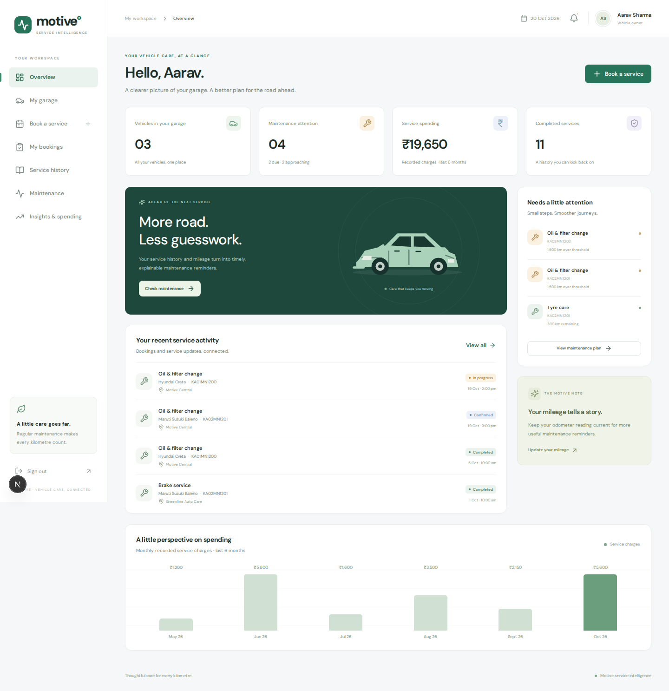
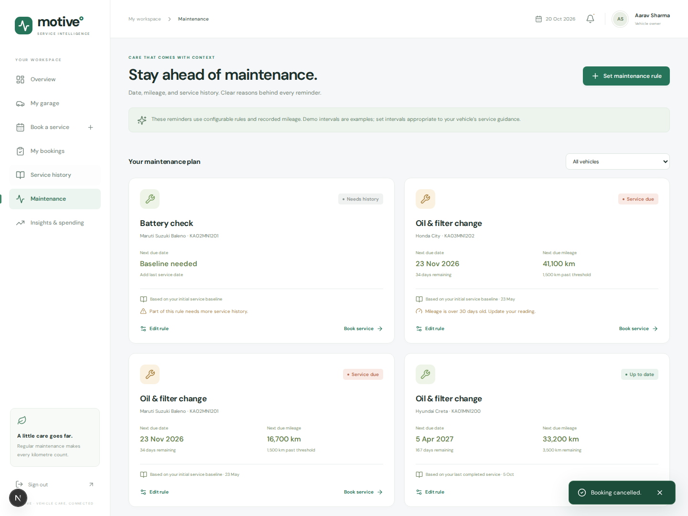
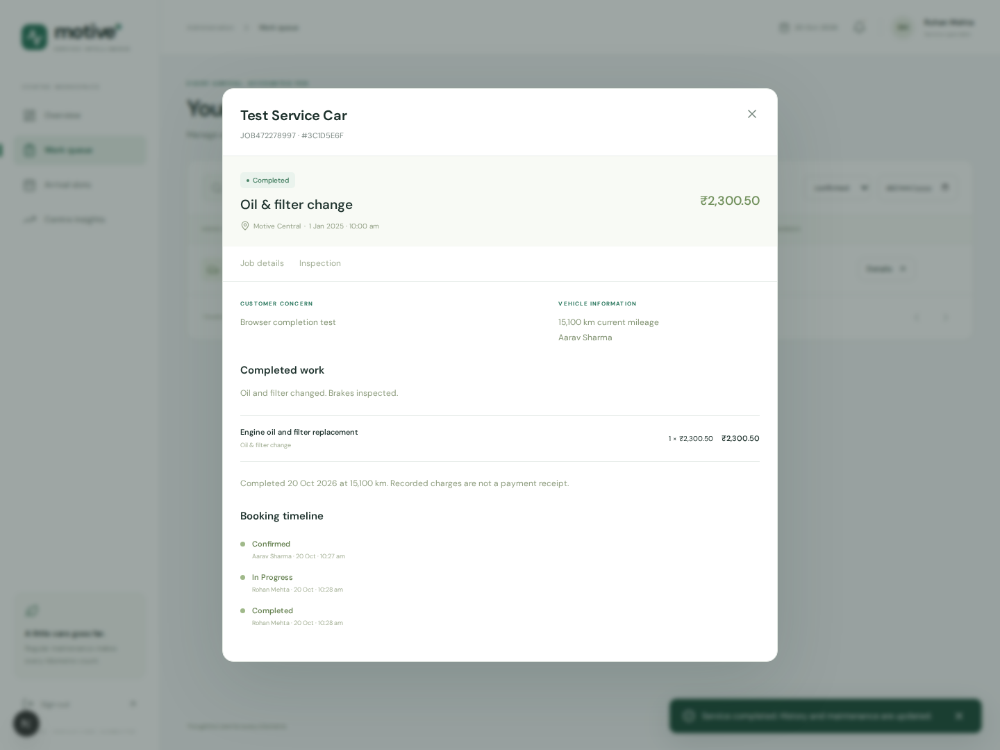
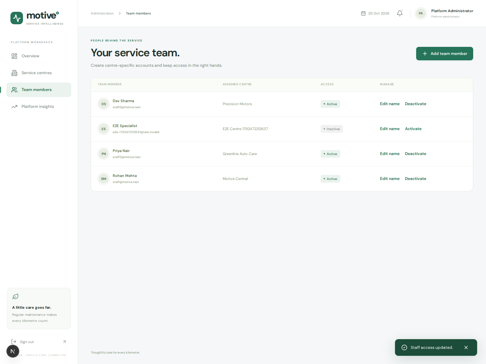
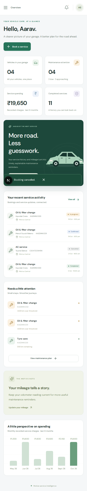

# Verification results

Verified locally on **20 October 2026** using Node.js 24.20.0, Next.js 16.4.2, PostgreSQL 17, MongoDB 8.0, and Playwright Chromium. These are recorded local results, not claims about a public deployment.

## Summary

| Check | Actual outcome |
|---|---|
| TypeScript | Passed |
| Optimized Next.js production build | Passed |
| Maintenance unit tests | **12 passed** |
| Real-database integration tests | **23 passed** |
| Browser workflow / API tests | **5 passed** |
| Explicit MongoDB outage exercise | Passed; container restarted in cleanup |
| Database consistency check | Passed |
| Production server sign-in/dashboard/logout | Passed for customer, staff, and administrator |
| Repeated setup | Passed without clearing data or duplicating the seed |

**40 automated tests passed**, plus the explicit outage and consistency checks. The staff completion browser check was also rerun with an assertion preserving `₹2,300.50` in the displayed total.

## What was exercised

### Maintenance calculations

Calendar-month clamping, leap February, Asia/Kolkata date boundaries, exact due thresholds, inclusive 30-day/500-km reminders, unknown baselines, a known due condition despite missing history, zero mileage, stale mileage, and date-only rules.

### PostgreSQL and MongoDB integration

- Two simultaneous callers competing for the last slot space produce one reservation.
- Request UUID replay returns the original booking; changed inputs conflict.
- Ownership and staff-centre restrictions apply inside controlled database functions.
- The runtime SQL account cannot directly modify protected bookings or mileage.
- Referenced slots cannot be changed/deleted, inactive centres cannot receive reservations, and conflicting vehicle bookings are rejected.
- Timing/mileage/baseline constraints reject invalid writes.
- The inspection-lock helper works without granting general booking UPDATE permission.
- Invalid service items roll back the entire completion; no record, item, state, or mileage is partially changed.
- Two simultaneous completions produce one record, exact decimal charges, and one completed transition.
- Audit entries contain the actual actor, and terminal states cannot reopen.
- MongoDB rejects malformed documents and duplicate booking inspections; stale revision updates do not overwrite newer data.
- Real customer/staff/admin reports execute successfully and return correctly shaped month values.
- Maintenance and repeated-fault queries return evidence from historical records.

### Browser and API workflows

1. Customer sign-in, garage addition, instant service booking, detail view, cancellation, history, maintenance, insights, and mobile navigation.
2. Staff sign-in, job start, checklist and measurement saving, service completion, persisted mileage, and exact displayed decimal amount.
3. Administrator sign-in, centre creation, staff creation, and staff deactivation.
4. Negative role/ownership/origin checks, rejected role escalation during registration, hashed-password verification, and logout invalidation.
5. Vehicle-description edits, mileage update/regression rejection, maintenance-rule creation/calculation, and slot create/edit/delete lifecycle.

Screenshots were inspected at desktop and mobile sizes. The mobile workflow explicitly checks for horizontal page overflow. Screenshot data includes temporary synthetic fixtures created by the tests; those records are cleaned afterward.

### MongoDB outage exercise

`npm run test:resilience` stops only the application's labelled local MongoDB container and restarts it in a `finally` block.

Observed behaviour during the outage:

- SQL reports returned HTTP 200 with `inspectionAnalyticsAvailable: false`.
- Inspection retrieval returned HTTP 503 with a retry message.
- Customer vehicle creation, booking, booking retrieval, and cancellation still succeeded.
- SQL test fixtures were removed and MongoDB was restarted.

### Consistency check after cleanup

The seeded dataset returned to **14 users, 15 vehicles, 44 bookings, 42 completed services, and 40 inspection documents**. There were zero booking/service-state mismatches, zero empty completed services, zero over-capacity slots, and zero orphan inspection documents.

## Reproduce

Start the app and databases as described in the README, then run:

```bash
npm test
npm run test:integration
npm run test:e2e
npm run test:resilience
npm run db:check
npm run build
```

Install Chromium with `npx playwright install chromium` before the first browser run. Browser tests require the app to be serving `APP_ORIGIN`. The outage exercise temporarily interrupts local inspection access and must be run separately from other tests.

## Verification limits

- No public hosting/deployment was performed.
- No 1,000-booking load benchmark, penetration test, or multi-instance rate-limit test was performed.
- No claim of full WCAG certification is made; keyboard controls, explicit labels, focus styles, and mobile overflow were checked within the implemented workflows.
- The two-member contribution history, title uniqueness, instructor approval, and final academic submission remain the team's responsibility.
- Payments, sensors, predictive ML, vector search, external notifications, and account recovery are outside this implementation's agreed scope.

## Screenshots

### Customer overview



### Maintenance evidence



### Staff completion



### Administrator team management



### Mobile overview


